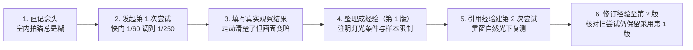

# 拾念 SHINIAN · 快速试用与功能导览教程

> **把试过的结果留住，下次遇到不用重试。**
>
> 拾念（SHINIAN）是一款中文、本地单机单人使用的个人经验与试错记录 Web 应用（同时适配**电脑网页端桌面三栏工作台**与**手机网页端 390px 触控视图**）。它围绕生活中的三个时刻设计：
> 1. **只有十秒**：随手记下一句话或一个困惑，不填标题、不选分类；
> 2. **现在有空**：从念头拆出一步小尝试，做完后如实填写「当时的条件与实际观察」；
> 3. **过了一阵子**：回来查「我当时试了什么、凭什么觉得它有用」，并把验证过的结论沉淀为可追溯版本的**经验**。

---

## 一、1 分钟启动与访问入口

### 1. 本地启动
在项目根目录（`d:\联动日程表`）下执行：

```bash
# 安装依赖（首次运行）
npm install

# 构建并启动服务（默认监听 http://127.0.0.1:3000，当前演示实例监听 http://127.0.0.1:3008）
npm start
```

### 2. 核心页面入口速查
| 页面 | 访问路径 | 用途说明 |
| :--- | :--- | :--- |
| **产品宣传页** | `/promo` | 3D 丝绸流体动态背景、产品理念、双端交互示意与「开始试用 →」入口 |
| **首页工作台** | `/` | 三合一入口：**「直记念头」「问 AI · 辅助记录」「问我的记录」** |
| **全局检索** | `/search` | 字面子串搜索 + 一跳关系扩展 + 可选 AI 替代关键词建议 |
| **主题（专题）** | `/topics` | 围绕持续探索的问题组织念头与经验，支持固定「下次继续」与导出 Markdown ZIP |
| **经验库** | `/experiences` | 查看所有已沉淀的经验、适用条件、限制与修订版本历史 |
| **知识网络（2D 图谱）** | `/graph` | Cytoscape.js + 60fps 弹簧物理牵引 + 视差流光粒子层，支持全局/局部 1-2 跳聚焦 |
| **念头日程与周期回顾** | `/schedule` / `/review` | 近 12 个月 53 周念头日程表热力图、阶段回顾与下一步行动排期联动 |
| **外部开源研究** | `/research` | 只读检索 GitHub 公开仓库元数据、README、许可证与 Release 并转化为小实验 |
| **模型与数据设置** | `/settings/ai` | 配置 OpenAI 兼容模型端点、GitHub Token、暗色/纸张主题切换、JSON 导出 |

---

## 二、第一条推荐试用路径：5 分钟走完「室内拍猫」全闭环（无需配置 AI）

即使完全不配置 AI 模型，拾念的核心闭环也能 100% 独立运行。推荐按以下 6 步体验：



### 步骤 1：10 秒直记一条念头
1. 打开首页 `/`（或从 `/promo` 点击右上角 **「开始试用 →」**）。
2. 在底部输入栏切换至 **「直记念头」** 模式。
3. 输入：
   > `为什么我在室内拍猫总是糊？`
4. 点击 **「记下」**。念头立即出现在左侧记录栏，无需填写任何标题或分类。

### 步骤 2：从念头发起第一次尝试
1. 在左侧栏点击刚记下的 **「为什么我在室内拍猫总是糊？」** 进入念头详情页。
2. 点击 **「自己写一步」**，在「新尝试步骤」中输入：
   > `同一盏灯下，快门从 1/60 调到 1/250，各拍五张。`
3. 点击 **「创建尝试」**。
   - **看点**：此时页面如实显示 `未开始 · 结果待记录`。在拾念中，只要你没填结果，哪怕过了几个月也只会显示「待记录」，绝不会因为时间过去就自动判为失败。

### 步骤 3：填写实测观察结果
1. 点击刚才创建的尝试进入 **尝试详情页（`/attempt/...`）**。
2. 将状态切换为 **「已完成」**，结果选为 **「达成」**（或「部分达成」）。
3. 在「结果文本」中输入你亲自观察到的现象：
   > `猫走动时清楚了，但画面变暗了。`
4. 点击 **「保存」**。

### 步骤 4：把有结果的尝试整理成「经验（第 1 版）」
1. 在尝试详情页底部，点击 **「整理成经验」** 按钮，唤起经验编辑弹窗：
   - **经验标题**：`室内高快门拍猫防糊经验`
   - **我的理解**：`提高快门到 1/250 可明显减轻室内拍猫动态模糊，但进光量减少会使画面变暗。`
   - **适用条件**：`室内单一台灯照明，拍走动中的猫`
   - **限制或反例**：`样本仅五张，未测自然光和高 ISO 噪点`
2. 点击 **「保存经验」**，再点击提示栏中的 **「打开经验详情」**。
   - **看点**：经验详情页清晰列出「我的理解」「适用条件」「限制」以及支撑该经验的**原始尝试来源卡片**（可随时点回原文核对）。

### 步骤 5：隔天回来搜索「快门」，引用经验发起第二次尝试
1. 点击左侧导航栏的 **「搜索」（`/search`）**，输入 `快门` 并回车：
   - 立即命中刚才的原始尝试结果与经验。
2. 回到 **经验详情页**，点击右上角 **「参考它，试一步」**：
   - 输入新尝试步骤：`靠窗自然光下用 1/250 快门复测拍猫`
   - 点击 **「创建尝试」**。

### 步骤 6：修订经验后，验证「版本快照可追溯」
1. 在经验详情页点击 **「编辑」**，将「我的理解」修改为：
   > `第 2 版修订：提高快门到 1/250 可防动态模糊，室内弱光需配合靠窗自然光或补光。`
2. 保存后，经验升级为 **「第 2 版」**。
3. 点击下方引用该经验创建的第二次尝试（`靠窗自然光下用 1/250 快门复测拍猫`）：
   - **核心看点**：尝试详情页顶部的版本横幅会清楚标明：**「本次尝试采用的是经验《室内高快门拍猫防糊经验》的第 1 版（当前该经验已修订至第 2 版）」**，并可展开对比当时采用的第 1 版快照！

---

## 三、进阶功能试用指南

### 1. 「问 AI · 辅助记录」与「问我的记录」（需在 `/settings/ai` 配置模型）
拾念严格约束 AI 边界：**模型只能帮你推敲计划或只读梳理已有记录，绝不能把模型建议伪造成你的实测结果。**

- **入口 A：首页 →「问 AI · 辅助记录」**
  1. 在首页切换至 **「问 AI · 辅助记录」**，输入：`帮我想想室内弱光拍猫怎么既不糊又不暗？`
  2. 模型流式回复讨论建议后，会自动在右侧/下方整理出一份 **「念头 + 尝试步骤草案卡片」**。
  3. 你可以直接修改草案中的任何一句话或步骤名称，点击 **「确认保存为念头与尝试」**。保存入库的尝试固定处于 `待执行（todo）` 状态，等你真正做完后再填结果。
- **入口 B：首页 / 导航栏 →「问我的记录（`/ask`）」**
  1. 输入问题（如 `我之前试过哪些改善拍猫模糊或台灯频闪的办法？`），点击 **「先检索本机记录」**。
  2. 系统先在本地检索出候选材料，由你**手动核对并勾选**本次允许发送给模型的记录（最多 8 条、12,000 字符）。
  3. 生成的回答会严格区分 **`[观察]`（直接来自你勾选记录的原文，带可点击来源编号）** 与 **`[推断]`（模型的引申分析）**，未勾选的记录绝不会混入回答。

### 2. 「研究一下」：GitHub 开源项目只读调研（`/research`）
当你想借鉴外部开源方案（例如做智能小车、离线语音唤醒）时：
1. 打开任意一条念头详情页（或左侧导航更多菜单中的 **「研究」**），点击 **「研究一下」**。
2. 在弹窗中确认研究问题（可展开「高级限制条件」填写硬件环境、语言、时间预算），选择 **「按关键词查找」**（如 `ros differential drive`）或 **「指定仓库地址」**（如 `owner/repo`）。
3. 点击 **「预览将发送的内容」** → **「开始检索候选」**：
   - **阶段 2（候选仓库）**：展示最多 10 个 GitHub 候选仓库（已自动清洗 SEO 乱码描述，提供 3 行摘要折叠与一行 5 列元数据对比）。勾选 **1–3 个仓库**，点击 **「深入比较」**。
   - **阶段 3 & 4（资料对比与小实验）**：系统只读拉取所选仓库的 README、许可证与 Release，生成带来源引用的对比报告与 **「可以先做的小实验」**。点击 **「编辑并试一步」** 即可把外部方案转化为你自己的尝试。

### 3. 2D 知识网络图谱：弹簧物理牵引与流光脉冲（`/graph`）
1. 点击左侧导航栏的 **「图谱」（`/graph`）** 进入知识网络画布：
   - **单击节点**：锁定该节点及其一跳关系网高亮，关联连线自动浮现关系标签（`包含`、`引用`、`依据`、`研究`、`采用`），并沿关系方向发射**动态流光脉冲粒子**；
   - **按住并拖拽节点**：默认开启 **60fps 弹簧物理力场**，与该节点相连的一跳邻居会像连接柔性弹簧一样实时弹性跟随移动，周围节点自动防重叠柔和避让；
   - **右下角悬浮 HUD 控制岛**：支持一键切换 `物理牵引`、点击 `✦ 舒展` 注入全图排斥舒展脉冲、平滑缩放，或在选中节点后点击 `◎ 聚焦邻域`；
   - **从问答/经验一键定位局部图**：在任何问答依据或经验来源卡片上点击 **「在图谱中查看」**，即使目标节点超出全局图默认 240 节点上限，也会精准切入该节点的 1 跳/2 跳局部图并自动选中，看完后点击顶部 **「← 返回刚才阅读的位置」** 即可原路返回。

### 4. 主题工作台、53 周念头日程表与阶段回顾（`/topics`、`/review`、`/schedule`）
- **主题（`/topics`）**：把散落的念头与经验收进同一个长期主题（如《室内拍猫清晰度专题》），支持置顶一条未完成尝试作为 **「下次继续」**，并支持一键 **「导出 Markdown（ZIP）」**（可在 Obsidian 中直接打开）。
- **周期回顾与热力图（`/review`）**：
  - 顶部展示**近 12 个月（53 周）念头日程表热力图**（支持点击右侧调色盘自定义热力图主题色，点击任意有记录的日期格即可按日回溯当天全部念头与尝试）；
  - 选择时间范围生成阶段回顾后，可从回顾结论直接点击 **「创建下一步行动」**，自由选择 **「只创建行动」** 或 **「同时加入日程」**。

### 5. 电脑网页版 vs 手机网页版双视图体验
- **电脑网页版**：大屏三栏深度工作台（左栏导航与列表 / 中栏核心读写画布 / 右栏上下文与图例）。
- **手机网页版**：将浏览器窗口缩窄至 `390px`（或用手机浏览器访问同一地址），自动切换为底部 56px 触控导航栏与防键盘遮挡吸底操作栏，适合现场 10 秒快记与随手填结果。
